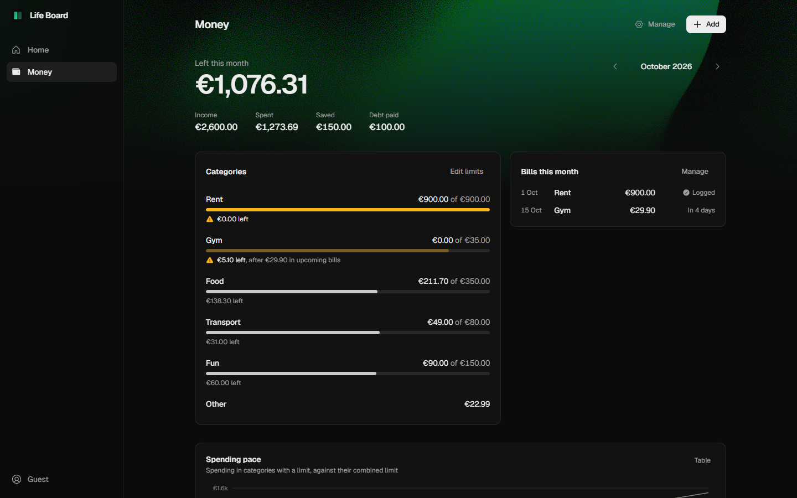
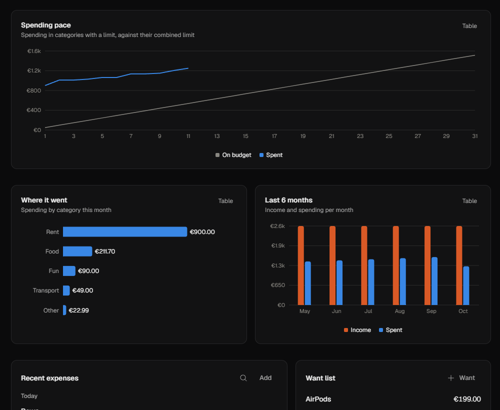
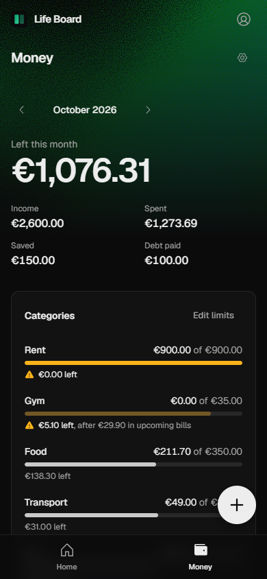

<div align="center">


# Life Board

**One calm place for your money, your day and your side projects.**

[](https://github.com/MohammedWishah/DashBoard/actions/workflows/deploy.yml)

[Open the app](https://app.mohammedwishah.com) · [Try it as a guest](#try-it) · [How it works](docs/HOW-IT-WORKS.md) · [API](docs/API.md)

</div>



## What it does

Life Board answers three questions at a glance: *How much can I still spend?* *What am I doing today?* *What's the next step on my projects?*

- **Money:** log expenses in two taps, set monthly limits per category, and see what's left. Recurring bills log themselves on their due day. Track income, savings goals and debts, with charts for each month.
- **Planner:** pick a top 3 for the day, tick daily, weekly and monthly habits, and watch your streaks grow.
- **Projects:** a side-project board that keeps you focused. At most two projects are active, each one shows its next concrete step, and shipped work is counted every week.
- **Home:** today's summary: money left, the next bill, and your next actions.

<table>
  <tr>
    <td width="72%"></td>
    <td></td>
  </tr>
</table>

## Highlights

- **Built for real life:** undo on every delete, amounts typed as `12,50` or `12.5`, and the month follows your time zone (Berlin), not the server's.
- **Private by design:** invite-only email login. Each person sees only their own data, and the admin chooses which sections each person gets.
- **Voice and chat:** a voice assistant or [Hermes](integrations/hermes/life-board/SKILL.md) on Telegram can log expenses, tick habits and send morning and evening check-ins.
- **Optional extras:** a want list that makes impulse buys wait a few days, forgiving streaks, a daily energy check-in, and a weekly wins card.
- **Phone-first:** works as an installable app, with a bottom bar and a quick-add button.

## Try it

**No account?** Click **Try as guest** on the sign-in screen. You get the full Money dashboard, running entirely in your browser. Nothing is sent to a server, and you can download your data anytime.

To run it locally:

```bash
git clone https://github.com/MohammedWishah/DashBoard.git
cd DashBoard
npm install
npm run dev:web
```

Open http://localhost:5173 and click **Try as guest**. No database or login setup is needed. For the full app with accounts, follow [docs/SETUP.md](docs/SETUP.md).

## Built with

| Layer | Tools |
| --- | --- |
| Frontend | React, TypeScript, Vite, Tailwind CSS, shadcn/ui, TanStack Query, Recharts |
| API | Hono on Cloudflare Pages Functions |
| Data | Cloudflare D1 (SQLite) with Drizzle ORM |
| Login | Supabase Auth (login only, no app data) |
| Shared | Zod schemas and business rules used by both the app and the API, tested with Vitest |

## Project layout

```
src/        React app: pages in routes/, UI in components/, data hooks in hooks/
functions/  The API (Hono) that runs on Cloudflare
shared/     Rules and schemas used by both sides
db/         Database schema and migrations
docs/       Setup, deploy, rules and API reference
```

## Docs

| Doc | What's inside |
| --- | --- |
| [How it works](docs/HOW-IT-WORKS.md) | Money and project rules, accounts and roles, extras, guest mode, design notes |
| [Setup](docs/SETUP.md) | Supabase login, local development, manual deploy |
| [Deploy](docs/DEPLOY.md) | How it reaches production, auto-deploy, troubleshooting |
| [API](docs/API.md) | Every route, including the voice assistant routes with `curl` examples |
